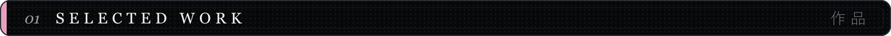
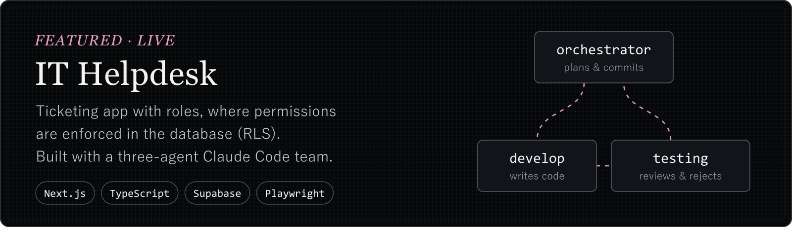
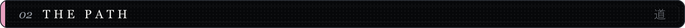
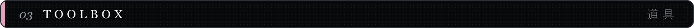
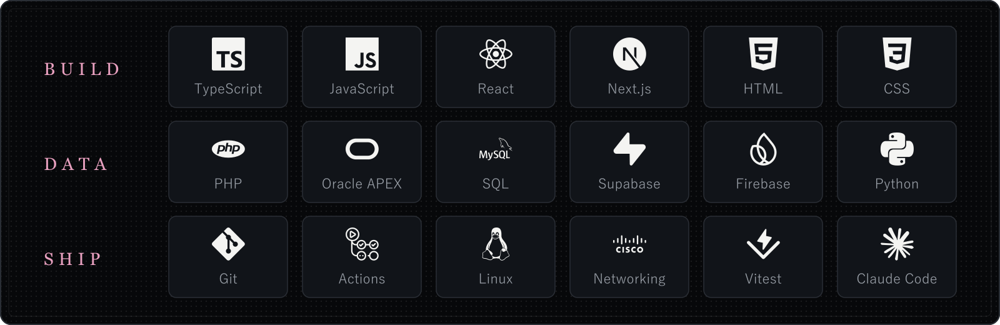
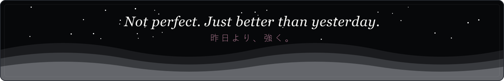

 

### I build web apps end to end, and I'm moving into cybersecurity.

IT support gave me the ground floor: Active Directory, VPN, 2FA and networks. 
Today I develop with **TypeScript, React, SQL, PHP and Oracle APEX**.

 

 

<a href="https://incidencias-app-nine.vercel.app"><b>Live demo →</b></a> &nbsp;·&nbsp; <a href="https://github.com/TenMM2/incidencias-app">Source code →</a>

<a href="https://github.com/TenMM2/habit-workspace">Source code →</a> &nbsp;·&nbsp; <a href="https://github.com/TenMM2/habit-workspace/blob/main/SECURITY.md">Security notes →</a>

<a href="https://github.com/TenMM2/jarvis-ai">Source code →</a>

 

 

| Status | Certification |
|:--|:--|
| ✅ &nbsp;Done | Google Cloud Cybersecurity Certificate |
| ✅ &nbsp;Done | Cisco · Introduction to Cybersecurity |
| ✅ &nbsp;Done | Google Workspace Administrator Professional Certificate |
| 🌸 &nbsp;Now | Google Cybersecurity Certificate |
| ⬜ &nbsp;Next | TryHackMe → CompTIA Security+ |

Roadmap and write-ups live in <a href="https://github.com/TenMM2/cybersecurity-portfolio">cybersecurity-portfolio</a>.

 

 

 

 

